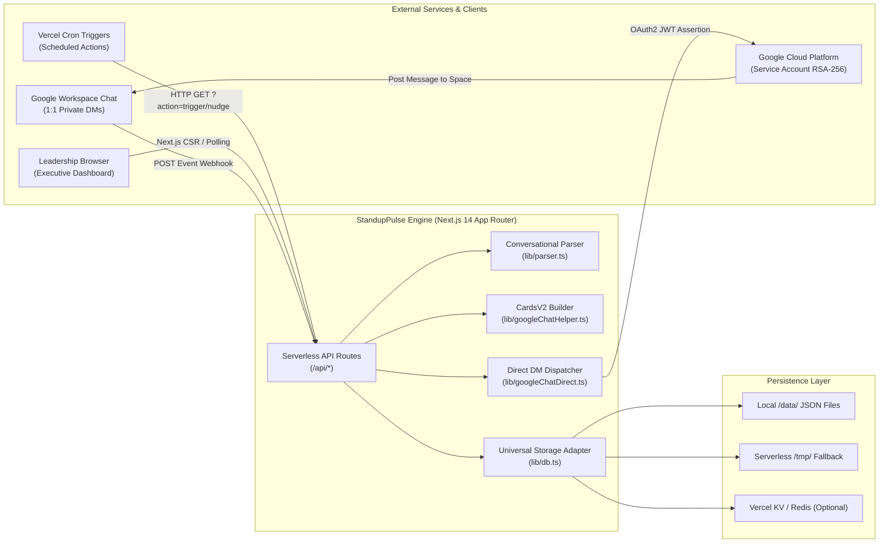
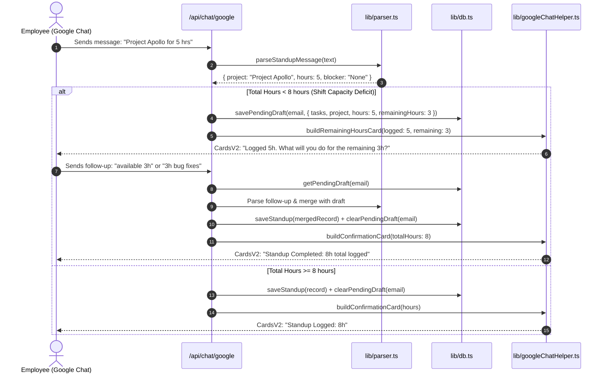

# StandupPulse Architecture

This document is the durable source of truth for the technical architecture, component boundaries, and operational lifecycles of **StandupPulse** (Executive Daily Standup Suite & Google Chat 1:1 Bot Engine).

---

## 1. System Purpose & Scope

### 1.1 Purpose
StandupPulse is an automated executive standup management suite built for engineering and product teams. It replaces chaotic group standups and cumbersome form wizards with direct 1:1 Google Chat DM interactions. Team members respond conversationally in natural language, and the system extracts itemized tasks, hours across multiple projects, and blocker/capacity warnings, compiling them into a real-time executive dashboard for engineering leaders and project managers.

### 1.2 Target Users & Personas
- **Team Members / Employees**: Receive proactive morning check-ins and contextual nudges directly inside Google Chat private DMs. They log tasks casually (e.g., `"Project Alpha for 4 hrs, Beta for 2 hrs, 2 hrs available"`).
- **Engineering Managers / Leads**: Monitor daily attendance, track progress across initiatives, detect blocked capacity, export formatted standup briefings, and download CSV reports from the dashboard.
- **System Administrators**: Configure schedules (default 10:30 AM IST prompt, 45-minute nudges with a strict 12:00 PM noon cutoff), upload Google Cloud Service Account credentials, and maintain the permanent team roster.

---

## 2. System Context & Boundaries

StandupPulse operates across three distinct operational layers:



### 2.1 Trust & Network Boundaries
1. **Google Chat Inbound Webhook**: Google Chat sends HTTP POST requests to `/api/chat/google`. Requests carry event metadata (`SPACE`, `MESSAGE`, `CARD_CLICKED`, `USER`).
2. **Google Chat Outbound API**: Serverless functions communicate with `https://chat.googleapis.com/v1/` using short-lived OAuth2 Bearer tokens minted via an RSA-256 signed JWT from a GCP Service Account.
3. **Executive Dashboard**: Served at `/` using React client components, communicating with internal API endpoints (`/api/standups`, `/api/employees`, `/api/settings`, `/api/trigger-bot`).

---

## 3. Component Architecture & Module Responsibilities

The codebase is organized under Next.js 14 App Router and modular TypeScript libraries:

```text
├── app/
│   ├── api/
│   │   ├── chat/google/route.ts      # Primary Google Chat webhook receiver
│   │   ├── chat-bot/route.ts         # Direct bot webhook relay
│   │   ├── employees/route.ts        # Employee directory CRUD & bulk hydration
│   │   ├── settings/route.ts         # Standup settings & cron configuration
│   │   ├── standups/route.ts         # Standup records query & management
│   │   └── trigger-bot/route.ts      # Manual trigger & cron dispatch endpoint
│   ├── globals.css                   # Tailwind styles, glassmorphism, animations
│   ├── layout.tsx                    # HTML shell, Outfit & Inter font imports
│   └── page.tsx                      # Executive dashboard (React 18 client component)
├── data/                             # Seed & persistent storage files
│   ├── employees.json                # Permanent employee roster
│   ├── settings.json                 # Operational parameters & prompts
│   └── standups.json                 # Standup records log
└── lib/                              # Core engine & services
    ├── db.ts                         # Multi-tier database adapter (Memory, File, KV)
    ├── googleChatDirect.ts           # Service account auth, space discovery, direct messaging
    ├── googleChatHelper.ts           # Google Chat CardsV2 UI builders & formatters
    ├── parser.ts                     # Conversational NLP parser & duration calculator
    └── types.ts                      # Core TypeScript definitions (Employee, StandupRecord, Settings)
```

### 3.1 Module Breakdown

#### `lib/parser.ts` (Intelligent Conversational Parser)
- **Multi-project splitting**: Recognizes phrases like `"project x for 3 and project y for 5 and testing for 1"`.
- **Duration normalizer**: Converts hours, decimals, and minutes (e.g. `30 mins` or `30m` -> `0.5h`).
- **Availability to Blocker conversion**: Matches available capacity (e.g. `available = 1.5`, `2h free`, `standby 1h`) and converts it to a blocker warning to alert leads about unassigned hours.
- **Special status detection**: Catches vacation, sick leaves, bench standby, and non-work activities.

#### `lib/googleChatDirect.ts` (Direct Service Account Engine)
- **Token management**: Mints RS256-signed JWTs for scope `https://www.googleapis.com/auth/chat.bot` with automated 1-hour caching.
- **1:1 Space discovery**: Automatically discovers private DM spaces by querying user memberships and space lists.
- **Cutoff enforcement**: Strictly disallows nudge reminders after **12:00 PM local time (IST)**.
- **Anti-spam guards**: Enforces 30-minute cooldowns per employee and checks recent space message history before sending.

#### `lib/googleChatHelper.ts` (CardsV2 Component Factory)
- Constructs valid Google Workspace Add-on CardsV2 payloads with header chips, action buttons, progress indicators, and interactive widgets.
- Builds prompt cards, remaining-hours clarification cards, and submission confirmations.

#### `lib/db.ts` (Universal Persistence Adapter)
- Multi-tier data store:
  1. In-memory hot cache for low-latency lookups.
  2. Local disk persistence (`data/*.json`).
  3. Serverless fallback (`os.tmpdir()`) when running on read-only container filesystems.
  4. Vercel KV / Redis integration if environment variables are configured.
- Supports **conversational draft state** (`pendingDraft`) indexed by employee email, allowing multi-turn conversations where an employee replies to clarification cards.

---

## 4. Data Flow & State Management

### 4.1 Standup Ingestion & Multi-Turn Clarification Flow



### 4.2 Proactive Cron & Nudge Lifecycle
1. **05:00 UTC (10:30 AM IST)**: Vercel Cron executes `/api/trigger-bot?action=trigger`.
2. The engine filters employees who have not yet submitted a standup for today.
3. Proactive standup prompt cards are sent to each eligible employee's 1:1 space.
4. **05:45 UTC (11:15 AM IST)**: Vercel Cron executes `/api/trigger-bot?action=nudge`.
5. The engine verifies local time < 12:00 PM. If true, nudges employees with pending standups or incomplete drafts.
6. **Past 12:00 PM IST**: The follow-up window closes. Any manual or cron trigger for `action=nudge` returns early without pinging employees.

---

## 5. Security & Trust Boundaries

1. **Authentication & Service Account Credentials**:
   - GCP credentials (`GOOGLE_SERVICE_ACCOUNT_KEY`) are stored in environment variables or within protected application settings.
   - Private keys are parsed and used in-memory for RSA-256 JWT signing; credentials are never exposed to client-side code.
2. **Git Secret Guard (Pre-commit hook)**:
   - Configured in `.githooks/pre-commit` and activated via `core.hooksPath`.
   - Blocks any commits containing unencrypted `.env` files, private keys, API keys, or OAuth credentials.
3. **Data Sanitization**:
   - User inputs from Google Chat are sanitized in `lib/parser.ts` to prevent prototype pollution or invalid character injections before persistence.

---

## 6. Operational Runbook & Deployment

### 6.1 Environment Variables
| Variable | Required | Description |
| :--- | :---: | :--- |
| `GOOGLE_SERVICE_ACCOUNT_KEY` | Recommended | Complete JSON string of GCP Service Account credentials |
| `GOOGLE_CLIENT_EMAIL` | Optional | Client email if key is provided separately |
| `GOOGLE_PRIVATE_KEY` | Optional | Private key RSA string with newlines |
| `KV_REST_API_URL` / `KV_REST_API_TOKEN` | Optional | Upstash/Vercel Redis connection for distributed serverless storage |

### 6.2 Deployment on Vercel
- StandupPulse deploys as a standard Next.js 14 App Router project.
- Crons configured in `vercel.json`:
  - `0 5 * * 1-5`: Mon-Fri 10:30 AM IST Morning Prompt (`/api/trigger-bot?action=trigger`)
  - `45 5 * * 1-5`: Mon-Fri 11:15 AM IST Follow-up Nudge (`/api/trigger-bot?action=nudge`)
