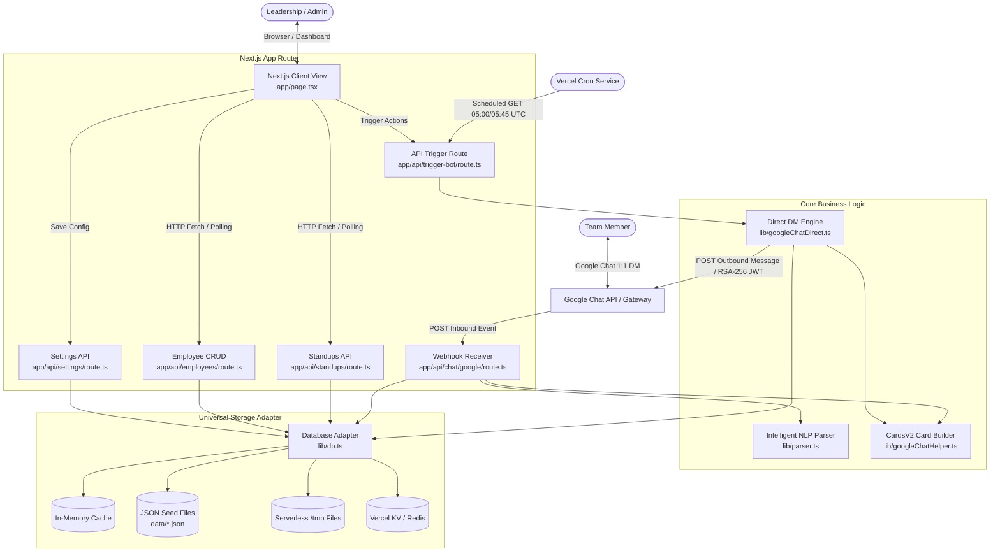
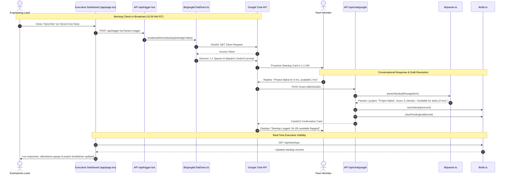
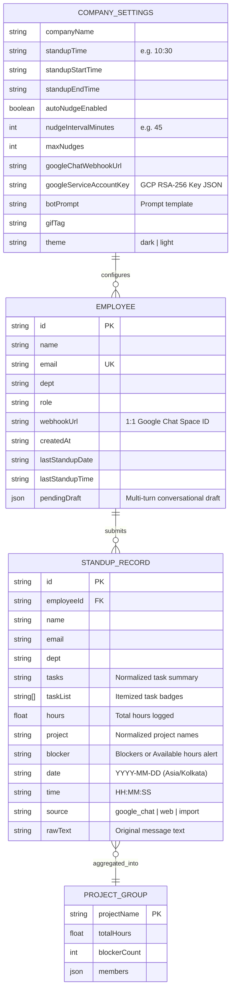

# Project Dependency & Relationship Graph

This document provides the structural wiring diagram for **StandupPulse**. It maps component hierarchies, API route call paths, database schemas, and blast-radius dependencies to enable safe refactoring and architectural analysis.

---

## 1. System Context & Component Graph

---

## 2. API Route & Call Flow Graph

---

## 3. Database Entity-Relationship (ER) Diagram

---

## 4. Blast Radius & Dependency Matrix

Use this table to check downstream impacts before modifying shared core modules:

| Core Module / File | Direct Dependents (Imported By) | Risk Level | Blast Radius Mitigation & Safeguards |
| :--- | :--- | :---: | :--- |
| `lib/types.ts` | All API routes, `lib/db.ts`, `lib/parser.ts`, `app/page.tsx` | **CRITICAL** | Run full TypeScript verification. Schema changes must account for legacy stored JSON. |
| `lib/db.ts` | All API routes (`/api/chat/google`, `/api/employees`, `/api/standups`, `/api/settings`, `/api/trigger-bot`) | **HIGH** | Test in-memory cache, file IO fallback, and draft state handling. Ensure atomic record overwrites for same-day standups. |
| `lib/parser.ts` | `app/api/chat/google/route.ts` | **HIGH** | Verify multi-project splitting, decimal hours (`30 mins` -> `0.5h`), available hours -> blocker conversion, and leave detection. |
| `lib/googleChatDirect.ts` | `app/api/trigger-bot/route.ts`, `app/api/chat/google/route.ts` | **HIGH** | Test RSA-256 JWT assertion, 30-minute anti-spam guard, and strict 12:00 PM noon cutoff logic. |
| `lib/googleChatHelper.ts` | `lib/googleChatDirect.ts`, `app/api/chat/google/route.ts` | **MEDIUM** | Validate Google CardsV2 JSON schema compatibility. Ensure button action payloads are valid JSON. |
| `app/api/chat/google/route.ts` | Google Chat Webhook infrastructure | **HIGH** | Verify handling of `MESSAGE`, `CARD_CLICKED`, `ADDED_TO_SPACE`, and `REMOVED_FROM_SPACE` events. |
| `app/page.tsx` | End-user leadership web dashboard | **MEDIUM** | Verify responsive rendering, table/grid view toggling, date filters (`Today` vs `All History`), and manual trigger buttons. |
| `.githooks/pre-commit` | Git CLI / Developer workflow | **HIGH** | Ensure pattern regex does not flag false positives on legitimate source code while blocking `.env` and private keys. |
